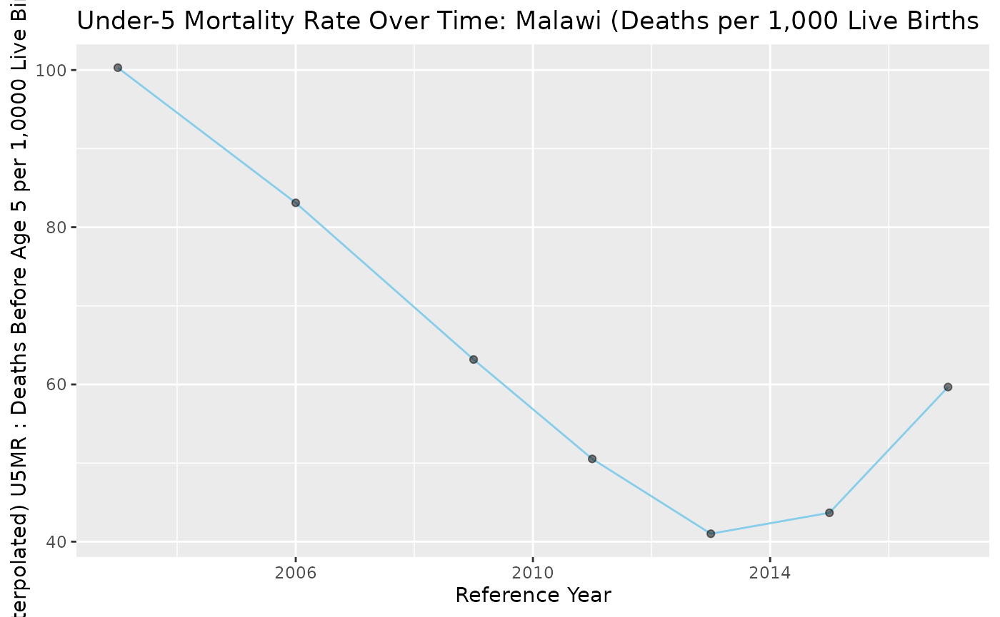
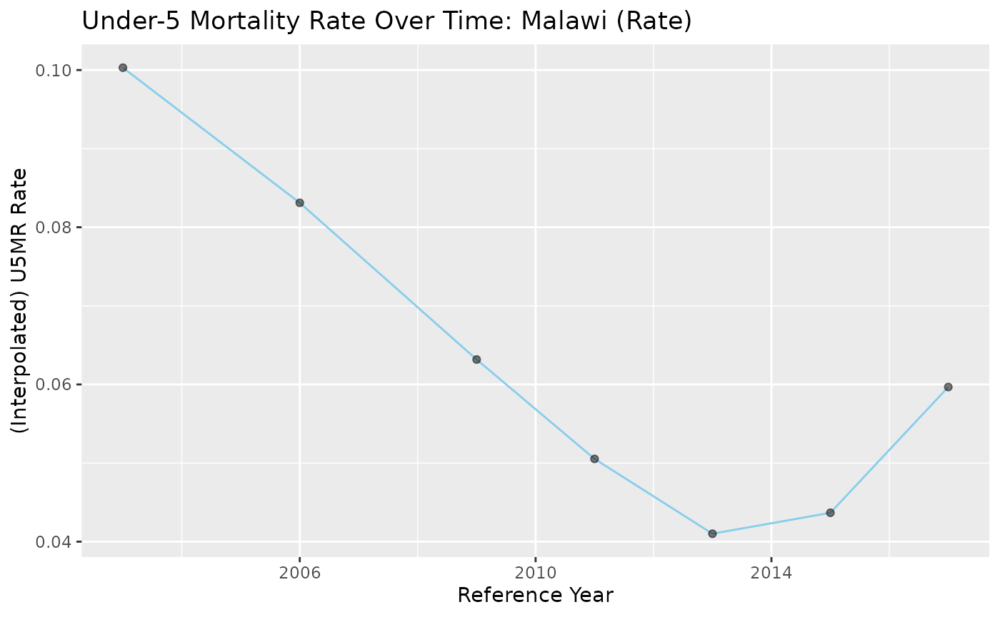

# SBH_Demo

``` r

library(SBHModeling)
library(readxl)
library(dplyr)
#> 
#> Attaching package: 'dplyr'
#> The following objects are masked from 'package:stats':
#> 
#>     filter, lag
#> The following objects are masked from 'package:base':
#> 
#>     intersect, setdiff, setequal, union
library(tidyr)
library(tidyverse)
#> ── Attaching core tidyverse packages ──────────────────────── tidyverse 2.0.0 ──
#> ✔ forcats   1.0.1     ✔ readr     2.2.0
#> ✔ ggplot2   4.0.3     ✔ stringr   1.6.0
#> ✔ lubridate 1.9.5     ✔ tibble    3.3.1
#> ✔ purrr     1.2.2
#> ── Conflicts ────────────────────────────────────────── tidyverse_conflicts() ──
#> ✖ dplyr::filter() masks stats::filter()
#> ✖ dplyr::lag()    masks stats::lag()
#> ℹ Use the conflicted package (<http://conflicted.r-lib.org/>) to force all conflicts to become errors
library(ggplot2)
library(patchwork)
```

## Demonstration on obtaining mortality rate estimates from SBH data to use in SAE models…

This vignette aims to demonstrate functions in this package using the
deterministic Brass approach to take SBH data and obtain mortality rate
estimates (i.e. the probability of dying before a given age) for
different ages (i.e. under-1 mortality… under-5 mortality .. etc.),
reconstruct mortality rate histories for a specified age through
interpolation, and also implement the results as covariates in SAE
(Small Area Estimation) models.

Specifically, we utilize SBH data on women aged from 15-49, with entries
split into 5 year age bands (15-19, 20-24, … , 45-49) to create a
measure of mortality - q(x) - the probability that a child dies before
age x. We index age bands as i = 1,2,3,4,5,6,7 for ease. We primarily
consider SBH information for BOTH female and male children combined,
rather than analyze by-sex information independently. If the latter was
desired, methods for obtaining q(x)’s would be similar, but to
reconstruct mortality rate histories for a given age via interpolation,
other life-death tables would need to be imported and used, as such life
tables are dependent on whether male, female, or both children are being
considered. Furthermore, functions are currently written to specifically
imply dataframes having entries (column names) for both sexes.

In this notebook, as an example we take information from the 2018 Malawi
Population and Housing Census’ fertility tables (holding data down to
the admin-1 level) as a test case. Users should be able to replicate the
code below as the data file is included in the package. In terms of SAE,
we are generally interested in nmr though this will come up in later
vignettes. We start by looking at Malawi as a whole without admin-1
granularity to demonstrate function usage. Note that the process of
cleaning the data to make it usable will depend on the structure of the
raw data itself, so the first section below is not necessarily
generalized to all sources. In future cases we may be interested in
using sources with more predictable structure like the census data
available on IPUMS.

### Data Import:

We take the data with the raw SBH information and convert it into a
readable dataframe. Each district has several rows for SBH information
corresponding to a specific age group. The data below is available in
the package itself and thus the code can be copied as is.

``` r

path <- system.file("extdata", "MalawiSBH1.xlsx", package = "SBHModeling")
#skip 4 since these rows correspond to nested headers
df <- readxl::read_excel(path, sheet = "Table B1", skip = 4, col_names = FALSE)

#rename columns to reflect original excel names...
colnames(df) <- c(
  "label",           # combination of age and district label (nested structure)
  "num_women",       # total pop of women
  "total_both",      # total children born (both sexes)
  "total_male",      # total male children
  "total_female",    # total female children
  "living_both",     # children still living (both sexes)
  "living_male",     # children still living (male)
  "living_female",   # children still living (female)
  "dead_both",       # children dead (both sexes)
  "dead_male",       # children dead (male)
  "dead_female"      # children dead (female)
)

df <- df %>%
  #create value for the distsrict column where it pulls from the label column only rows with no - , + 
  mutate(region = ifelse(!grepl("-|\\+", label), label, NA)) %>%
  #fill the district name down so every row has a corresponding district label
  fill(region, .direction = "down") %>%
  #remove the NA rows / only keep rows where the label is a valid age range
  filter(grepl("-|\\+", label)) %>%
  #reorder
  rename(age_group = label) %>%
  dplyr::select(region, age_group, everything())

print(head(df, 12))
#> # A tibble: 12 × 12
#>    region age_group num_women total_both total_male total_female living_both
#>    <chr>  <chr>         <dbl>      <dbl>      <dbl>        <dbl>       <dbl>
#>  1 Malawi 12-14        762334       1565        794          771        1469
#>  2 Malawi 15-19       1031165     234947     119709       115238      224169
#>  3 Malawi 20-24        873999    1040403     524370       516033     1000422
#>  4 Malawi 25-29        646545    1511774     759866       751908     1452437
#>  5 Malawi 30-34        590721    2112446    1057130      1055316     2005636
#>  6 Malawi 35-39        500810    2247289    1124715      1122574     2095324
#>  7 Malawi 40-44        362429    1906246     951831       954415     1723472
#>  8 Malawi 45-49        262119    1501565     745533       756032     1310500
#>  9 Malawi 50-54        199412    1201330     593285       608045     1001726
#> 10 Malawi 55-59        162875    1016249     497713       518536      813727
#> 11 Malawi 60-64        127098     822680     401794       420886      624534
#> 12 Malawi 65+          378674    2472145    1188665      1283480     1599523
#> # ℹ 5 more variables: living_male <dbl>, living_female <dbl>, dead_both <dbl>,
#> #   dead_male <dbl>, dead_female <dbl>
```

As we are only interested in age groups 15-19 up until 45-49, we filter
out the other age groups and create an index column, i, ranging from 1:7
for each of the age groups, along with select Malawi as a whole for the
region. Thus, it should be noted that after selecting the proper age
groups, any given region’s information should span 7 rows (assuming
complete information available).

``` r

df <- df %>% filter(
  age_group %in% c(
    "15-19", "20-24", "25-29", "30-34", "35-39", "40-44", "45-49")) %>% 
  mutate(i = case_when(
age_group == "15-19" ~ 1,
age_group == "20-24" ~ 2,
age_group == "25-29" ~ 3,
age_group == "30-34" ~ 4,
age_group == "35-39" ~ 5,
age_group == "40-44" ~ 6,
age_group == "45-49" ~ 7))

malawi <- df %>% filter(region == 'Malawi')
print(malawi)
#> # A tibble: 7 × 13
#>   region age_group num_women total_both total_male total_female living_both
#>   <chr>  <chr>         <dbl>      <dbl>      <dbl>        <dbl>       <dbl>
#> 1 Malawi 15-19       1031165     234947     119709       115238      224169
#> 2 Malawi 20-24        873999    1040403     524370       516033     1000422
#> 3 Malawi 25-29        646545    1511774     759866       751908     1452437
#> 4 Malawi 30-34        590721    2112446    1057130      1055316     2005636
#> 5 Malawi 35-39        500810    2247289    1124715      1122574     2095324
#> 6 Malawi 40-44        362429    1906246     951831       954415     1723472
#> 7 Malawi 45-49        262119    1501565     745533       756032     1310500
#> # ℹ 6 more variables: living_male <dbl>, living_female <dbl>, dead_both <dbl>,
#> #   dead_male <dbl>, dead_female <dbl>, i <dbl>
```

### Constructing q(x):

We begin by constructing q(x) - the probability that a child dies by age
x, for a given x. We outline the method briefly here:

Each age band corresponds to a specific value of x - for example, the
age group of 15-19 corresponds to computing q(1). Similarly:  
15-19: i = 1, x = 1  
20-24: i = 2, x = 2  
25-29: i = 3, x = 3  
30-34, i = 4, x = 5  
35-39, i = 5, x = 10  
40-44, i = 6, x = 15  
45-49, i = 7, x = 20

Let the average parity per woman for the specified age group i be
defined as P(i) = CEB(i) / FP(i), where CEB(i) is the number of children
ever born to (corresponding to total_both in our dataframe), and FP(i)
be the total number of women in the age group i (corresponding to
num_women in our dataframe).

Then, let the fraction of children dead to mothers in the age group i be
D(i), with D(i) = CD(i) / CEB(i), with CD(i) being the number of
children who died to mothers in age group i (corresponding to dead_both
in our dataframe).

To compute q(x), we take the age group i corresponding to the x of
interest and then use the formula:  
q(x) = D(i) \* {a(i) + b(i)\[P(1)/P(2)\] + c(i)\[P(2)/P(3)\]}

The coefficients for a, b, and c come from Coale-Demeny life tables.
These can be found in UN Manual X: Indirect Techniques for Demographic
Estimation, Table 47 (Coefficients for estimation of child mortality
multipliers, Trussell variant). The coefficients will change depending
on the family being utilized, though for ease we have included them all
in the function itself such that the user can specify which to use.

The inputs of the function should then be:  
- A dataframe specific to a region with 7 rows, one for each age group
from 15-19 up until 45-49. There should be columns explicitly named:
region, num_women, total_both, and dead_both. There should also be a
column named i corresponding to the age groups.  
- An integer, i, ranging from 1:7 and corresponding to the x in the q(x)
being computed  
- The family for the life tables being used (‘North’, ‘West’, ‘East’,
‘South’)  
One can also refer to the reference page for documentation. The reason
for using a (region’s) dataframe opposed to a single row for computing a
single q(x) is that the equation requires computing parity for several
age groups.

The returns will then be the region name, the q(x), and k(x), which is
essentially the multiplier of D(i) above, or in other words, the portion
of the equation : {a(i) + b(i)\[P(1)/P(2)\] + c(i)\[P(2)/P(3)\]}

Alternative explanations with more depth can be found in Ch. 3 of the
Manual, or for a condensed explanation the paper: ‘A probabilistic model
for analyzing summary birth history data’ by Wilson, Wakefield.

As an example, we compute q(5), or U5MR, using the West family, s.t. i =
4:

``` r

sbh_brass_qx(malawi, 4, 'West')
#> $region
#> [1] "Malawi"
#> 
#> $ki
#> [1] 0.9993204
#> 
#> $qi
#> [1] 0.05052788
```

### Constructing t(i) / recovering the reference year:

We now move to constructing t(i). Each calculation above of q(x) from a
given age group is not necessarily based on the census year itself, but
rather from a prior reference year (as keep in mind different aged women
imply estimates from varying times).

The framework is somewhat similar, where we use the equation:  
t(i) = {e(i) + f(i)\[P(1)/P(2)\] + g(i)\[P(2)/P(3)\]}  
and the final reference year can be taken by subtracting t(i) from the
original census year.

The e, f, and g coefficients similarly come from simulations of
Coale-Demeny life tables. In this package, we use those in the same
Manual X but in Table 48 (Coefficients for estimation of the reference
period to which the values of q(x) estimated from data classified by age
refer).

The inputs for the function are about identical to the previous
function, with the addition of the census year, which should be a single
(4-digit) integer referring to the year that the census was executed.

As an example, we compute t(5), or the reference period for U5MR, s.t. i
= 4:

``` r

sbh_brass_ti(malawi, 4, 'West', 2018)
#> [1] 2011.156
```

### Obtaining comprehensive estimates for a region

To obtain all q(x)s and reference years for a given region, we can
simply iterate through all rows of that region’s SBH information and
obtain a dataframe like so:

``` r

region_name <- c()
ks <- c()
qs <- c()
yrs <- c()

for (i in 1:7){
  result_brassq <- sbh_brass_qx(malawi, i, 'West')
  region_name[i] <- result_brassq$region
  ks[i] <- result_brassq$ki
  qs[i] <- result_brassq$qi
  yrs[i] <- sbh_brass_ti(malawi, i, 'West', 2018)

}

malawi_results <- data.frame(region = region_name,
                          q_i = qs, k_i = ks, i = 1:7, x = c(1,2,3,5,10,15,20), ref_year = yrs)
malawi_results
#>   region        q_i       k_i i  x ref_year
#> 1 Malawi 0.04649312 1.0134921 1  1 2016.854
#> 2 Malawi 0.03916067 1.0190560 2  2 2015.477
#> 3 Malawi 0.03864409 0.9845651 3  3 2013.488
#> 4 Malawi 0.05052788 0.9993204 4  5 2011.156
#> 5 Malawi 0.06889286 1.0188014 5 10 2008.609
#> 6 Malawi 0.09655789 1.0070529 6 15 2005.905
#> 7 Malawi 0.12713859 0.9991723 7 20 2003.004
```

### Reconstructing historical estimates for a given q(x)

As seen above, we now have the means of obtaining q(x) for i = 1:7 for a
given region, along with the reference year. What if instead of looking
at q(x)’s corresponding to different mortality rates (i.e. under-1
mortality, under-5 mortality, etc.), we wanted to look at a single
measure, i.e. U5MR, as a historical time series?

We can do this through (Brass-Macrae Method) linear interpolation, by
converting different q(x) measures to other q(y)s. For example, if we
had a q(1) estimate and a reference year, we could convert that q(1) to
q(5) to obtain the U5MR estimate for that year. The conversion is done
again by utilizing Coale-Demeny tables (specific to families).
Essentially, the life tables have information on ‘mortality levels’ and
for each, the associated q(x)s. If we are interested in converting our
estimated q(x) to q(y), we go down the column for the corresponding q(x)
in the life table and find the value closest to our estimated value, and
then find the q(y) value for that row. Generally, we use linear
interpolation in practice to interpolate between the mortality levels in
the tables.

As defined in (Wilson, Wakefield),  
Specifically, letting j = the level and qe(x) being the estimated
q(x),  
q_j+1(x) \< q_e(x) + q_j(x)

Then, q(y) = (1-h)q_j(y) + hq_j+1(y)  
and h = \[q_e(x) - q_j(x)\]/\[q_j+1(x) - q_j(x)\]

The life tables can be found in the ‘Step-by-Step Guide to the
Estimation of Child Mortality’ manual by the UN. Specifically, we refer
to Tables A.I.9. - A.I.12, ‘Model values for probabilities of dying,
q(x), both sexes combined (for a given family)’. Again, we encode these
in the functions themselves.

The function then starts by defining a helper function (operation for a
single row) where for a given q(x) result (denoted qe(x) above), and a
defined y to convert to q(y), along with a specific life death table to
refer to, the interpolated estimate of q(y) based on qe(x) and a life
table (contingent on selecting the family) is returned. Then, the
function of interest applies this to a dataframe similar to the one in
the section above having the comprehensive estimated q_i’s, reference
years, and x’s for all age bands for a given region. The user specifies
the family for the table they want to use along with what q(y) they want
to convert all of the result qe(x)s to. The returned product will be the
same inputted summary dataframe but now with an appended column for the
under_i mortality rates for the age of interest.

If you have been using the package functions up to this point, then if
you input the dataframe from the step above where the q(x) estimates and
reference year estimates are obtained and held in that exact dataframe
format, then you can directly input that into the interpolation
function, as all the column names will precisely match (which is indeed
required for usage). Similarly, the family is just the same family
you’ve been using throughout, and the input y should be a single integer
that can be in the set {1,2,3,5,10,15,20}, which just specifies what
historical mortality rates you are interested in obtaining. For more
information on the inputs, one can view the reference page.

``` r

malawi_q5 <- sbh_interpolation_complete(malawi_results, 'West', 5)
malawi_q5
#> # A tibble: 7 × 7
#> # Rowwise: 
#>   region    q_i   k_i     i     x ref_year  q5_mr
#>   <chr>   <dbl> <dbl> <int> <dbl>    <dbl>  <dbl>
#> 1 Malawi 0.0465 1.01      1     1    2017. 0.0597
#> 2 Malawi 0.0392 1.02      2     2    2015. 0.0437
#> 3 Malawi 0.0386 0.985     3     3    2013. 0.0410
#> 4 Malawi 0.0505 0.999     4     5    2011. 0.0505
#> 5 Malawi 0.0689 1.02      5    10    2009. 0.0632
#> 6 Malawi 0.0966 1.01      6    15    2006. 0.0831
#> 7 Malawi 0.127  0.999     7    20    2003. 0.100
```

We can also plot the results (both as the mortality rate raw and deaths
per 1,000 live births, which is frequently displayed)

``` r

malawi_q5 %>% mutate(ref_year_rd = round(ref_year),
                       u5mr_per_1000 = q5_mr * 1000) %>% ggplot(
  aes(x = ref_year_rd, y = u5mr_per_1000)) + geom_line(color='skyblue') + geom_point(alpha=0.5) + labs(
    title = 'Under-5 Mortality Rate Over Time: Malawi (Deaths per 1,000 Live Births',
    x = 'Reference Year',
    y = '(Interpolated) U5MR : Deaths Before Age 5 per 1,0000 Live Births)')
```



``` r


malawi_q5 %>% mutate(ref_year_rd = round(ref_year)) %>% ggplot(
  aes(x = ref_year_rd, y = q5_mr)) + geom_line(color='skyblue') + geom_point(alpha=0.5) + labs(
    title = 'Under-5 Mortality Rate Over Time: Malawi (Rate)',
    x = 'Reference Year',
    y = '(Interpolated) U5MR Rate')
```



So what is the point of all of this… for one it may be of interest to
obtain different age-specific (national) mortality rate estimates over
time to create time-series like that above, and then compare those to
estimates from different sources (i.e. childmortality.org). But also
recall that since we can take any specific district dataframe, if we
have the data for sub-national areas we can also obtain these estimates
and time-series at finer geographic granularity. More importantly, the
goal of obtaining these estimates is to use them as covariates in SAE
methods - specifically the Fay-Herriot model. For nmr especially, using
SBH information can be of great interest given the possibility for
different (estimated) mortality rates to be highly correlated with the
outcome and thus increase precision of model estimates.

As an example of how one might obtain covariates for mortality rate
estimates at a given level (i.e. q(1) since this is the closest we have
to nmr), we show an example below with the data loaded in initially that
doesn’t contain just the national level, but also districts
corresponding to admin-1 granularity in the surveyPrev/SUMMER package.
We filter out the national and northern/central/southern region entries
since these are at a larger geographic level than admin-1. The rest of
the areas are admin1 areas (and/or fractions of them).

``` r

df_ad1 <- df %>% filter(!(region %in% c('Malawi', 'Northern Region', 'Central Region', 'Southern Region')))

districts <- unique(df_ad1$region)
q1s_west <- vector('list', length(unique(df_ad1$region)))

q1s_west <- lapply(districts, function(dist) {
  dist_df <- df_ad1 %>% dplyr::filter(region == dist)
  #adjust for i as needed here
  sbh_brass_qx(dist_df, 1, 'West')$qi
})

data.frame(district = districts,
           q1_w = unlist(q1s_west))
#>          district       q1_w
#> 1         Chitipa 0.05243302
#> 2         Karonga 0.04360339
#> 3       Nkhatabay 0.04691349
#> 4          Rumphi 0.04344291
#> 5          Mzimba 0.05091521
#> 6          Likoma 0.06206872
#> 7      Mzuzu City 0.03353816
#> 8         Kasungu 0.05125200
#> 9      Nkhotakota 0.04577698
#> 10        Ntchisi 0.05187005
#> 11           Dowa 0.05637333
#> 12         Salima 0.04595999
#> 13 Lilongwe Rural 0.05494543
#> 14        Mchinji 0.04893741
#> 15          Dedza 0.05151612
#> 16         Ntcheu 0.04462808
#> 17  Lilongwe City 0.04982897
#> 18       Mangochi 0.04421292
#> 19       Machinga 0.04782479
#> 20    Zomba Rural 0.04336279
#> 21     Chiradzulu 0.04440231
#> 22 Blantyre Rural 0.03170167
#> 23         Mwanza 0.05557607
#> 24         Thyolo 0.04297145
#> 25        Mulanje 0.04385964
#> 26       Phalombe 0.04621827
#> 27       Chikwawa 0.04218193
#> 28         Nsanje 0.04365220
#> 29         Balaka 0.04227668
#> 30           Neno 0.03066900
#> 31     Zomba City 0.04933034
#> 32  Blantyre City 0.04517367
```

We do stress that estimates using this deterministic method ARE NOT
perfect and we don’t expect them to be - we just intend on using them as
auxiliary information in other models. We will cover using these in SAE
models in a different vignette. THANKS FOR VIEWING.
