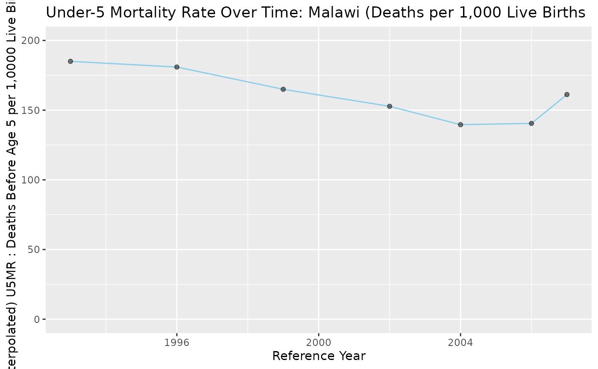

# SBH_IUSSP_Verification

``` r

library(SBHModeling)
library(readxl)
library(dplyr)
```

    ## 
    ## Attaching package: 'dplyr'

    ## The following objects are masked from 'package:stats':
    ## 
    ##     filter, lag

    ## The following objects are masked from 'package:base':
    ## 
    ##     intersect, setdiff, setequal, union

``` r

library(tidyr)
library(tidyverse)
```

    ## ── Attaching core tidyverse packages ──────────────────────── tidyverse 2.0.0 ──
    ## ✔ forcats   1.0.1     ✔ readr     2.2.0
    ## ✔ ggplot2   4.0.3     ✔ stringr   1.6.0
    ## ✔ lubridate 1.9.5     ✔ tibble    3.3.1
    ## ✔ purrr     1.2.2

    ## ── Conflicts ────────────────────────────────────────── tidyverse_conflicts() ──
    ## ✖ dplyr::filter() masks stats::filter()
    ## ✖ dplyr::lag()    masks stats::lag()
    ## ℹ Use the conflicted package (<http://conflicted.r-lib.org/>) to force all conflicts to become errors

``` r

library(ggplot2)
library(patchwork)
```

## Comparison of Brass-Method estimates and comparison with IUSSP construction

This vignette aims to demonstrate calculations based on the functions as
outlined in the SBH_Demo vignette matching up with the worked example on
IUSSP’s ‘Indirect estimation of child mortality’ page, which goes
through a Malawi 2008 census at the national level. The exact table can
be seen on the page (Table 7.) but we just manually code it here due to
its short length.

``` r

# table 7: children ever born and children surviving
# malawi, 2008 census

malawi_2008 <- data.frame(
  age_group = c("15-19", "20-24", "25-29", "30-34","35-39", "40-44", "45-49"),
  number_women = c(635927, 678071, 566350, 405602, 298004, 221274, 174875),
  children_ever_born = c(180178, 1038556, 1613374, 1697566, 1553676, 1335242, 1128423),
  children_surviving = c(161541, 919584, 1398776, 1426516, 1266514, 1043357, 851048),
  mean_children_ever_born = c(0.2833, 1.5316, 2.8487, 4.1853, 5.2136, 6.0343, 6.4527),
  mean_children_surviving = c(0.2540, 1.3562, 2.4698, 3.5170, 4.2500, 4.7152, 4.8666),
  proportion_dead = c(0.1034, 0.1145, 0.1330, 0.1597, 0.1848, 0.2186, 0.2458))
malawi_2008
```

    ##   age_group number_women children_ever_born children_surviving
    ## 1     15-19       635927             180178             161541
    ## 2     20-24       678071            1038556             919584
    ## 3     25-29       566350            1613374            1398776
    ## 4     30-34       405602            1697566            1426516
    ## 5     35-39       298004            1553676            1266514
    ## 6     40-44       221274            1335242            1043357
    ## 7     45-49       174875            1128423             851048
    ##   mean_children_ever_born mean_children_surviving proportion_dead
    ## 1                  0.2833                  0.2540          0.1034
    ## 2                  1.5316                  1.3562          0.1145
    ## 3                  2.8487                  2.4698          0.1330
    ## 4                  4.1853                  3.5170          0.1597
    ## 5                  5.2136                  4.2500          0.1848
    ## 6                  6.0343                  4.7152          0.2186
    ## 7                  6.4527                  4.8666          0.2458

As the format is slightly different, we rename columns and recover the
number of child deaths (from total of children born - those who
survived). The calculated children deaths divided by the children ever
born column matches the proportion_dead column in the original
dataframe. On the site, the proportions are directly utilized but our
function uses the raw numbers and calculates within.

``` r

malawi_2008 <- malawi_2008 %>% mutate(
  dead_both = children_ever_born - children_surviving,
  region = 'Malawi', 
  i = c(1:7)) %>% 
  select(region, i, age_group, number_women, children_ever_born, dead_both) %>%
  rename(num_women = number_women,
         total_both = children_ever_born)
malawi_2008
```

    ##   region i age_group num_women total_both dead_both
    ## 1 Malawi 1     15-19    635927     180178     18637
    ## 2 Malawi 2     20-24    678071    1038556    118972
    ## 3 Malawi 3     25-29    566350    1613374    214598
    ## 4 Malawi 4     30-34    405602    1697566    271050
    ## 5 Malawi 5     35-39    298004    1553676    287162
    ## 6 Malawi 6     40-44    221274    1335242    291885
    ## 7 Malawi 7     45-49    174875    1128423    277375

The outline on the site utilizes the North model from the Princeton
family (see outline for justification). We start by finding q(x) and the
corresponding reference year for each age group. As the census was taken
in June (18th, estimated) of 2008, we use 2008.46 for the year.

``` r

region_name <- 'Malawi'
ks <- c()
qs <- c()
yrs <- c()

for (i in 1:7){
  result_brassq <- sbh_brass_qx(malawi_2008, i, 'North')
  ks[i] <- result_brassq$ki
  qs[i] <- result_brassq$qi
  yrs[i] <- sbh_brass_ti(malawi_2008, i, 'North', 2008.46)

}

malawi_results <- data.frame(region = region_name,
                          q_i = qs, k_i = ks, i = 1:7, x = c(1,2,3,5,10,15,20), ref_year = yrs)
malawi_results
```

    ##   region       q_i       k_i i  x ref_year
    ## 1 Malawi 0.1062826 1.0275145 1  1 2007.413
    ## 2 Malawi 0.1104794 0.9644202 2  2 2006.030
    ## 3 Malawi 0.1222343 0.9189724 3  3 2004.025
    ## 4 Malawi 0.1527532 0.9566821 4  5 2001.653
    ## 5 Malawi 0.1884964 1.0198506 5 10 1999.017
    ## 6 Malawi 0.2205149 1.0087561 6 15 1996.231
    ## 7 Malawi 0.2441052 0.9930741 7 20 1993.341

This matches the results from the outline, which are pasted below as
screenshots for reference.


Table 9: NQ0 estimates (corresponding to q_i in results dataframe)


Table 10: Reference date estimates (corresponding to ref_year in results
dataframe)

We also construct mortality rate estimates for all qxs after being
converted to under 5 mortality. The exact formula and inputs for the
life table-related variables also displayed on the site outline. These
calculations also match up with our function’s, and once again, the
table from the site is attached here for reference.

``` r

malawi_q5 <- sbh_logit_interpolation_complete(malawi_results, 'North', 5)
malawi_q5
```

    ## # A tibble: 7 × 7
    ## # Rowwise: 
    ##   region   q_i   k_i     i     x ref_year q5_mr
    ##   <chr>  <dbl> <dbl> <int> <dbl>    <dbl> <dbl>
    ## 1 Malawi 0.106 1.03      1     1    2007. 0.161
    ## 2 Malawi 0.110 0.964     2     2    2006. 0.140
    ## 3 Malawi 0.122 0.919     3     3    2004. 0.140
    ## 4 Malawi 0.153 0.957     4     5    2002. 0.153
    ## 5 Malawi 0.188 1.02      5    10    1999. 0.165
    ## 6 Malawi 0.221 1.01      6    15    1996. 0.181
    ## 7 Malawi 0.244 0.993     7    20    1993. 0.185


Table 11: Q5MR date estimates (corresponding to q5_mr in results
dataframe)

We also plot the above q5mr (per 1.000 births) results as a time-series
here.

``` r

malawi_q5 %>% mutate(ref_year_rd = round(ref_year),
                       u5mr_per_1000 = q5_mr * 1000) %>% ggplot(
  aes(x = ref_year_rd, y = u5mr_per_1000)) + geom_line(color='skyblue') + geom_point(alpha=0.5) + ylim(0,200) + labs(
    title = 'Under-5 Mortality Rate Over Time: Malawi (Deaths per 1,000 Live Births',
    x = 'Reference Year',
    y = '(Interpolated) U5MR : Deaths Before Age 5 per 1,0000 Live Births)')
```


