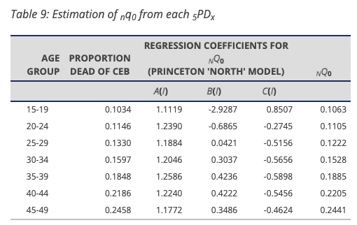
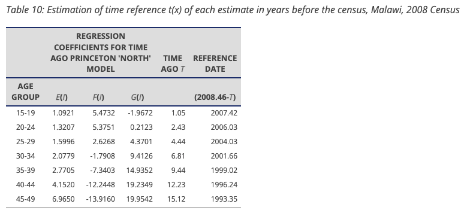
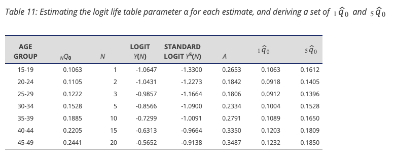

```{r, include = FALSE}
knitr::opts_chunk$set(echo = TRUE)
```

```{r setup}
library(SBHModeling)
library(readxl)
library(dplyr)
library(tidyr)
library(tidyverse)
library(ggplot2)
library(patchwork)
```

# Comparison of Brass-Method estimates and comparison with IUSSP construction
This vignette aims to demonstrate calculations based on the functions as outlined in the SBH_Demo vignette matching up with the worked example on IUSSP's 'Indirect estimation of child mortality' page, which goes through a Malawi 2008 census at the national level. The exact table can be seen on the page (Table 7.) but we just manually code it here due to its short length.

```{r}
# table 7: children ever born and children surviving
# malawi, 2008 census

malawi_2008 <- data.frame(
  age_group = c("15-19", "20-24", "25-29", "30-34","35-39", "40-44", "45-49"),
  number_women = c(635927, 678071, 566350, 405602, 298004, 221274, 174875),
  children_ever_born = c(180178, 1038556, 1613374, 1697566, 1553676, 1335242, 1128423),
  children_surviving = c(161541, 919584, 1398776, 1426516, 1266514, 1043357, 851048),
  mean_children_ever_born = c(0.2833, 1.5316, 2.8487, 4.1853, 5.2136, 6.0343, 6.4527),
  mean_children_surviving = c(0.2540, 1.3562, 2.4698, 3.5170, 4.2500, 4.7152, 4.8666),
  proportion_dead = c(0.1034, 0.1145, 0.1330, 0.1597, 0.1848, 0.2186, 0.2458))
malawi_2008
```

As the format is slightly different, we rename columns and recover the number of child deaths (from total of children born - those who survived). The calculated children deaths divided by the children ever born column matches the proportion_dead column in the original dataframe. On the site, the proportions are directly utilized but our function uses the raw numbers and calculates within. 

```{r}
malawi_2008 <- malawi_2008 %>% mutate(
  dead_both = children_ever_born - children_surviving,
  region = 'Malawi', 
  i = c(1:7)) %>% 
  select(region, i, age_group, number_women, children_ever_born, dead_both) %>%
  rename(num_women = number_women,
         total_both = children_ever_born)
malawi_2008
```

The outline on the site utilizes the North model from the Princeton family (see outline for justification). We start by finding q(x) and the corresponding reference year for each age group. As the census was taken in June (18th, estimated) of 2008, we use 2008.46 for the year.

```{r}
region_name <- 'Malawi'
ks <- c()
qs <- c()
yrs <- c()

for (i in 1:7){
  result_brassq <- sbh_brass_qx(malawi_2008, i, 'North')
  ks[i] <- result_brassq$ki
  qs[i] <- result_brassq$qi
  yrs[i] <- sbh_brass_ti(malawi_2008, i, 'North', 2008.46)

}

malawi_results <- data.frame(region = region_name,
                          q_i = qs, k_i = ks, i = 1:7, x = c(1,2,3,5,10,15,20), ref_year = yrs)
malawi_results
```

This matches the results from the outline, which are pasted below as screenshots for reference. 





We also construct mortality rate estimates for all qxs after being converted to under 5 mortality. The exact formula and inputs for the life table-related variables also displayed on the site outline. These calculations also match up with our function's, and once again, the table from the site is attached here for reference. 

```{r}
malawi_q5 <- sbh_logit_interpolation_complete(malawi_results, 'North', 5)
malawi_q5
```



We also plot the above q5mr (per 1.000 births) results as a time-series here.

```{r}
malawi_q5 %>% mutate(ref_year_rd = round(ref_year),
                       u5mr_per_1000 = q5_mr * 1000) %>% ggplot(
  aes(x = ref_year_rd, y = u5mr_per_1000)) + geom_line(color='skyblue') + geom_point(alpha=0.5) + ylim(0,200) + labs(
    title = 'Under-5 Mortality Rate Over Time: Malawi (Deaths per 1,000 Live Births',
    x = 'Reference Year',
    y = '(Interpolated) U5MR : Deaths Before Age 5 per 1,0000 Live Births)')
```

